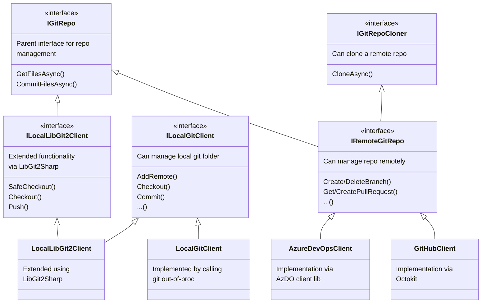

This document describes some of the architecture of the code in `DarcLib`, especially classes for managing git.

### Git clients

The `DarcLib` has several git-related classes which manage either a local git directory or a remote GitHub/AzureDevOps repository. The Maestro service can then open most PRs remotely without having to have to clone the repository whereas the `Darc` tool needs to be able to manage local repositories.

- The local repositories are either managed by calling `git` out-of-proc or by using the `LibGit2Sharp` library.
- The remote repositories are managed via 3rd party client libraries (OctoKit / AzDO clients).
- Other classes then only use `IGitRepo` which is enough for most of the operations (e.g. `DependencyFileManager` can read and change files in a repo without knowing if it's local or remote).

### GitHub conditional requests

When `GitHubClient` receives a response cache, its Octokit connection revalidates
cached responses using `If-None-Match`. This applies only to GET requests for
individual pull requests, pull request commits, combined commit statuses, and
commit check runs, including their query parameters and pagination. These are
the Octokit reads used when `PullRequestUpdater.GetPullRequestStatusAsync`
checks a PR. Other callers of those endpoints also benefit; writes, other
endpoints, Azure DevOps, and the separate raw REST client are unchanged.

Each cache entry contains the response body, headers, and ETag. Requests are
always sent to GitHub: a `304 Not Modified` reuses the cached response and the
caller continues normally, including merge-policy evaluation. Other responses
are processed normally, and errors are not replaced with cached data.
Authenticated `304` responses do not consume GitHub's primary rate limit,
but conditional requests do not eliminate HTTP calls or check-run writes.

`RemoteFactory` passes the existing `ICache` delegate to the GitHub client.
PCS registers this delegate as `RedisCacheClient`, backed by `IRedisCacheFactory`,
so serialized response entries are shared across replicas and rollouts rather
than stored in `DarcRemoteMemoryCache`. Cache writes are awaited before a fresh
response returns. Entries have a one-day Redis TTL; eviction or expiration
results in an ordinary GET. Clients without a supplied response cache do not
use conditional requests.

Cache keys are `GitHubConditionalResponse:v1:` followed by the complete request
URI, including query parameters. This allows sharing across replicas, token
refreshes, and rollouts without including installation IDs or request headers
in the key. This cache assumes consistent media types and API versions for
the allowlisted endpoints. Every reuse still requires successful revalidation
using the current token; authorization errors are never replaced with cached
data.

The pipeline replays the saved response headers on a `304`, so rate-limit
headers on that replay are not current telemetry. Cache read exceptions are
logged and propagated. Failed `TrySetAsync` writes are logged, while the fresh
GitHub response remains usable.

